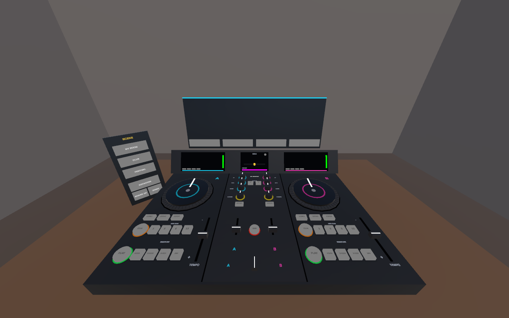
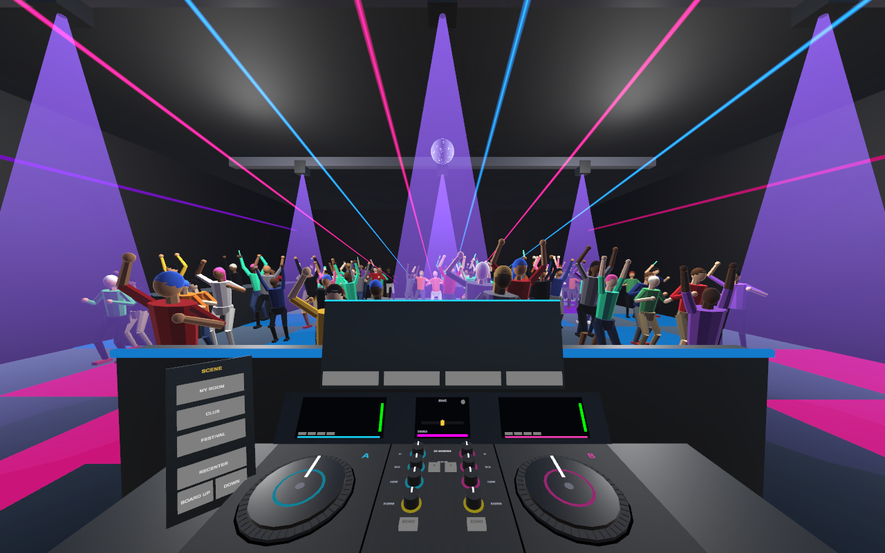
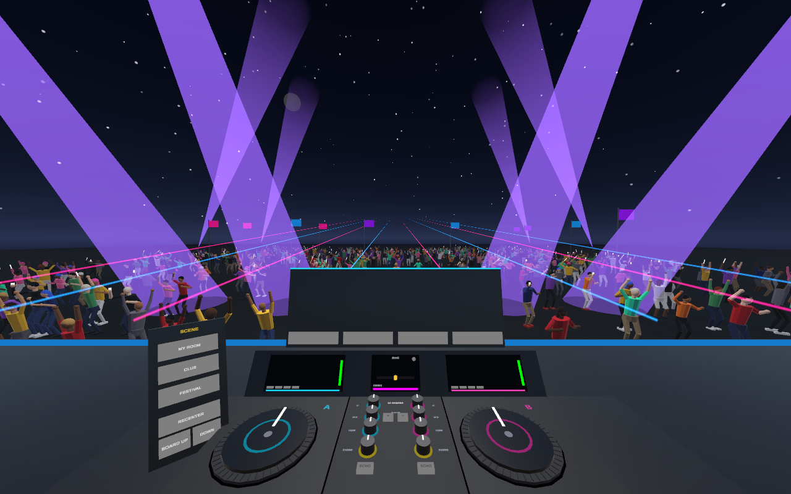
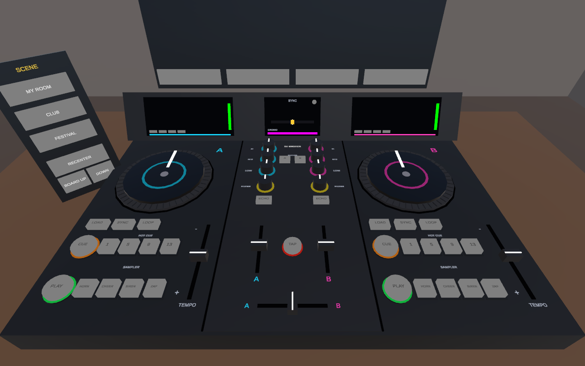
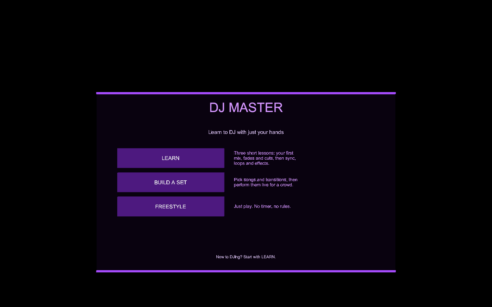
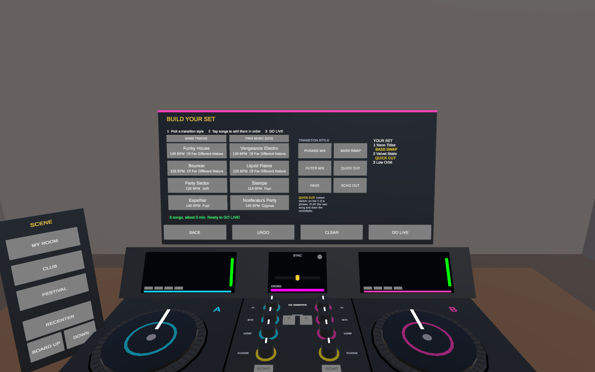

# DJ MASTER

Learn to DJ with just your hands. A mixed reality DJ school for Meta Quest.

A full two-deck DJ controller appears on your real desk: big jog wheels, round CUE and PLAY buttons, hot cue and sampler pads,
tempo faders, and a mixer with EQs, filters, channel faders and a crossfader.
It starts on its own black start screen with a purple menu: pick a mode, then where to play, then step into the booth.

| Mode | What you do |
|---|---|
| **Learn** | Three short guided lessons: 1 First Mix (the color code and your first beatmix), 2 Fade & Cut (the DJ loop, no beatmatching needed), 3 Sync, Loops & FX. |
| **Build a set** | Choose 2-5 songs and the transition into each one, then perform the set live with a step-by-step checklist. Every transition is graded and recorded, and the set gets a critique. |
| **Freestyle** | Just play. No timer, no rules. |

| Venue | |
|---|---|
| **My room** | Mixed reality: your real surroundings through passthrough. |
| **Club** | Lasers, a mirror ball, an LED wall and a packed dance floor. |
| **Festival** | A night-time main stage with fireworks and a huge crowd. |

The crowd reacts to your mixing in every venue, and the SCENE panel switches venues at any time.

No controllers needed. Every interaction is a fingertip poke, slide or spin.

| Your room (mixed reality) | Club | Festival |
|---|---|---|
|  |  |  |



| Start screen | Build a set |
|---|---|
|  |  |

*Editor renders. On Quest, the "room" view is your real room through passthrough.*

## Color code

Every control has a color, and Learn mode opens with a quick quiz on it:

| Color | Means |
|---|---|
| Blue | Deck A (left), including its LOAD and SYNC |
| Pink | Deck B (right) |
| Green | PLAY |
| Orange | CUE, the HOT CUE pads (jump to bar 1, 5, 9 or 13) and LOOP |
| Yellow | FILTER, ECHO and PHONES: effects, and what only you hear |
| Red | TAP and the SAMPLER pads (horn, cheer, siren, zap): for the crowd |

**COLOR-BLIND mode** (on the start screen) swaps in a palette that stays distinct for every common type of color
blindness, and gives every color a shape, on the board and in every lesson, so nothing relies on color alone:
◄ Deck A, ► Deck B, ● PLAY, ■ CUE, ♦ FX and PHONES, ♥ CROWD. The setting is saved between sessions.

## What you learn

The lessons follow the techniques chapter of Digital DJ Tips' free *Rock The Dancefloor* course
(the basic DJ workflow, the three elements of a beatmix, the five basic transitions, sync, hot cues and loops,
EQ, filters and effects, and recording and critiquing your sets), rebuilt as hands-on steps.

**Lesson 1: First Mix** (20 steps, about 7 minutes). The control you need next pulses gold, and a hint appears if you're stuck.

| # | Skill | What you do |
|---|---|---|
| 1-4 | Color code | Touch something blue, pink, yellow and orange |
| 5-7 | Decks and faders | Press PLAY, raise the channel fader, crossfade to Deck A |
| 8 | Feel the beat | Tap the TAP pad on four kicks in a row |
| 9 | Phrasing | Tap exactly on a 4-bar line (bar 1, 5, 9, 13) |
| 10-12 | Cueing | LOAD Deck B, preview it in the headphones (PHONES), press PLAY |
| 13 | Beatmatch: tempo | Ride Deck B's TEMPO fader until both BPMs match |
| 14 | Beatmatch: phase | Nudge Deck B's jog wheel until the SYNC light turns green |
| 15-18 | The blend | Cut the bass, bring Deck B in, swap the basslines, finish the transition |
| 19-20 | Effects | Filter sweep and the air horn |

**Lesson 2: Fade & Cut** (13 steps, about 4 minutes): the DJ loop (load, preview in PHONES, cue, bring in, stop the old
song), then a **fade** (a clear dip, about 10 seconds of fading, the new song dropped on a phrase; it tells you if you fade too fast)
and a **cut** (hot cue to bar 1, then PLAY and crossfader together on a phrase line, with no overlap).

**Lesson 3: Sync, Loops & FX** (11 steps, about 5 minutes): tap tempo (it shows the BPM you tap), SYNC, a
**single-phrase beatmix** held for 8 bars, a 4-bar **loop**, and an **echo out**, ending with "less is more".

## Build a set

Tap a transition style, then tap songs in the crate to add them in order. Each song is mixed in with the style that was
selected when you added it:

| Style | How it's done | Graded on |
|---|---|---|
| Phrase mix | Preview in PHONES, beatmatch, bring it in on a phrase, play both for about 8 bars, crossfade. | 4-20 bars in sync, entered on a phrase line |
| Bass swap | Cut the new song's LOW, beatmix, then trade basslines. | New LOW cut on entry, no muddy bass, no clashing |
| Filter mix | Beatmix while sweeping the old song's FILTER. | Filter used, no clashing |
| Quick cut | Match the tempo, CUE to bar 1, then PLAY and slam the crossfader on a phrase line. | No overlap, on bar 1, 5, 9 or 13 |
| Fade | Dip the old song's fader, fade it over about 10 seconds, start the new song on a phrase. | 6-25 s fade, new song on a phrase |
| Echo out | ECHO on, cut the old song's fader on a phrase, drop the new song while the echoes fade. | Echo on at the cut, new song on a bar line within 4 s |

The builder warns when a beatmix joins songs more than 4% apart in tempo, and suggests a fade, cut or echo out instead.

**GO LIVE** performs the set. The next song is loaded for you, and a checklist walks you through each planned
transition with the right controls glowing. Each transition is graded PERFECT / GOOD / ROUGH with a tip. Crowd energy
rises for in-sync blends and bass drops (cut the LOW, slam it back on a bar line). It falls for trainwrecks, muddy
bass clashes, silence and leaving the ECHO on for too long (less is more). Your set is saved between sessions.

After the set, **LISTEN BACK** replays a recording of each transition, and a critique shows how much of your mixing
time the beats were in sync, the seconds of clashing and silence, and the one thing to practise next.

## Hand controls

| Control | Gesture |
|---|---|
| Buttons and pads | Poke down from above. Brushing past from the side won't trigger them. |
| Faders | Touch the cap and slide. The tempo fader is geared 1:3 for fine control and clicks into 0%. |
| Knobs | Touch the top and slide your finger away/right to turn up, toward you/left to turn down. Double-tap to reset to center. |
| SYNC / LOOP / ECHO | SYNC matches tempo and lines up the beats. LOOP repeats the current 4-bar phrase. ECHO is a beat-synced echo after the fader, so pulling the fader down lets the echoes ring out. |
| Jog wheels | Rest a fingertip on the platter and spin: clockwise speeds the track up, counter-clockwise slows it. When paused, it scrubs. |

A glowing dot on each index fingertip shows exactly where you're touching, and turns gold while you're holding a control.
The platters turn once per bar with their white marker pointing forward on beat 1, so two in-phase tracks have matching markers.

**Scene panel** (to the left of the board): MY ROOM / CLUB / FESTIVAL, RECENTER, and BOARD UP / DOWN for comfort.

## Designed for the hackathon guidelines

- **Hands-first:** everything works with hands alone. Nothing needs a controller.
- **Seated, airplane-seat friendly:** the board snaps in front of you at desk height, with every control inside arm's reach. RECENTER and height buttons are always available.
- **Bus-stop test:** cold start lands you on the menu with tracks preloading. One lesson is about 7 minutes and a 3-song set about 3. Taking the headset off or opening the system menu pauses audio and time, and the game resumes where you left off.
- **Original, not a wrapper:** all eight tracks are synthesized at runtime by `TrackSynth` (house, techno and disco loops, arranged in DJ phrases). There is no licensed music, no streaming, and no third-party services.

## Run it in the editor (no headset)

1. Open the project in **Unity 6000.6.4f1** and open `Assets/Scenes/DJMaster.unity`.
2. Press Play. The view starts tilted down at the board, and the mouse acts as a fingertip:
   - **Left click / drag:** press buttons, drag faders, turn knobs (drag up/right), spin the jog wheels
   - **Scroll wheel:** turn the knob under the cursor
   - **Right drag:** look around

To regenerate the scene after changing the builder: **DJ Master > Build Scene**.

## Build to Quest

1. **Unity Hub > Installs > 6000.6.4f1 > Add modules > Android Build Support** (include OpenJDK and Android SDK & NDK).
2. **DJ Master > Configure Player Settings for Quest** (IL2CPP, ARM64, min API 32, package `com.djmaster.vr`, hands only at high tracking frequency + passthrough).
3. **File > Build Profiles > Android > Switch Platform**.
4. **Edit > Project Settings > XR Plug-in Management > Android tab:** check **OpenXR**, then under OpenXR enable the **Meta XR** feature group. Then open **Edit > Project Settings > Meta XR**, pick the Android tab and click **Fix All**.
5. Put the Quest in developer mode, connect over USB, then **Build And Run**.

**For the competition:** upload the APK to a release channel named **Competition** in the Meta Developer Dashboard and create an Invite URL for the judges.

## Tests

- **EditMode (24):** mixer math (constant-power crossfader, EQ curve, tempo range, phase wrap), synth loop length/levels/kick timing, text wrap with color tags, tap tempo, sync math, set lists (add, undo, save/load, tempo-gap advice), set stars.
- **PlayMode (10):** loads the real scene and drives it with a simulated fingertip. Covers poking PLAY (and *not* triggering it from the side), fader drags, the fine-geared tempo fader, venue switching, menu > venue > color quiz, a full Learn run from step 1 to "LESSON COMPLETE", full runs of lessons 2 and 3, building and performing a set with a perfect phrase mix and quick cut, and a set with a perfect fade and echo out that checks the recordings and LISTEN BACK.

Run them from **Window > General > Test Runner**.

## Project map

```
Assets/DJMaster/
  Scripts/Audio/        TrackSynth (procedural music), TrackLibrary, Deck (hot cues, loops), ChannelStrip (EQ/filter/echo DSP),
                        Mixer, MixRecorder (listen back), Sfx, DJMath
  Scripts/Interaction/  Pointer, HandPointerSource (index fingertip), MousePointerSource, PokeButton, Fader, Knob, JogWheel
  Scripts/Game/         GameDirector (menus and modes), LessonDirector (Learn), SetList + SetPerformer (Build a set / live show),
                        MixJudge (crowd energy + score), DJBoard
  Scripts/UI/           BoardColors (the color code), DeckDisplay, SyncMeter, InstructionPanel, SetBuilderPanel
  Scripts/World/        EnvironmentManager (passthrough/club/festival), SeatedAnchor, Crowd (GPU-instanced), LightShow, MeshKit
  Shaders/              Additive + Glow (single-pass stereo safe)
  Editor/SceneBuilder.cs  builds the entire scene from primitives
```

Built with the Meta XR Core SDK v207 (OVRCameraRig, OVRHand/OVRSkeleton with OpenXR hand skeletons, OVRPassthroughLayer).
