# DJ MASTER

Learn to DJ with just your hands. A mixed reality DJ school for Meta Quest.

A full two-deck DJ controller appears on your real desk: big jog wheels, round CUE and PLAY buttons, hot cue and sampler pads,
tempo faders, a mixer with GAIN, EQs, filters, level meters, channel faders and a crossfader, and three screens: a scrolling
waveform on each deck and a song browser in the middle. It looks like club gear at night: brushed metal, rubber pads with LED
rims, LED rings on every knob, and buttons that flash when you hit them.

It starts on its own start screen: a greeting with what to try next, then pick who's playing, a mode, your level, then where to play, and step into the booth.

| Mode | What you do |
|---|---|
| **Learn** | Four short guided lessons: 1 First Mix (drop the bass, the color code and your first beatmix), 2 Fade & Cut (the DJ loop, gain, no beatmatching needed), 3 Sync, Loops & FX, 4 Next Song (picking what's next by tempo and key). |
| **Build a set** | Choose 2-5 songs from a crate of 16 (8 game tracks and 8 free CC0 songs) and the transition into each one, then perform the set live with a step-by-step checklist. Every transition is graded and recorded, and the set gets a critique. |
| **Freestyle** | Just play. No timer, no rules. |
| **Daily** | A new challenge set every day. Pass it days in a row to build a streak, and 3 days unlocks a bonus song. |
| **DJ Vocab** | A list of 24 DJ words (BPM, phrase, cue, bass swap, train wreck...) with what each one means, and a QUIZ ME button for a 10-question multiple-choice quiz. Your best score is saved. |

**Levels:** BEGINNER (easy timing, quick hints), INTERMEDIATE (SYNC, the live checklist and the phrase countdown),
ADVANCED (no SYNC, no checklist, no countdown: beatmatch by ear) and SOLO (just DJ, no rules, no score).

**Players:** up to 4 people can share one headset. Each keeps their own lessons, scores, streak, level and saved set.

| Venue | |
|---|---|
| **My room** | Mixed reality: your real surroundings through passthrough. |
| **Club** | Lasers, a mirror ball, an LED wall and a packed dance floor. |
| **Festival** | A night-time main stage with fireworks and a huge crowd. |

The crowd reacts to your mixing in every venue, and the SCENE panel switches venues at any time. Every dancer is their
own person (build, skin tone, hair and outfit). They bounce at the knees and nod on the beat, and as the energy rises they
go from grooving to hands in the air, fist pumps, jumps, phones and glow sticks.

No controllers needed. Every interaction is a fingertip poke, slide or spin.

| Your room (mixed reality) | Club | Festival |
|---|---|---|
| 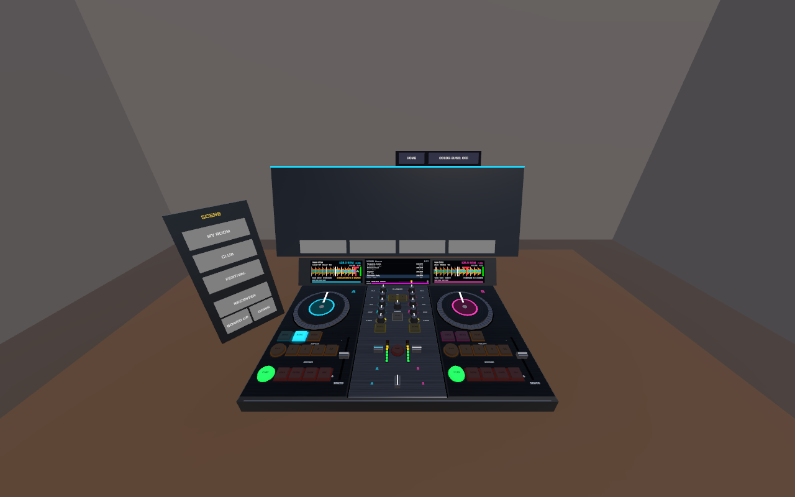 | 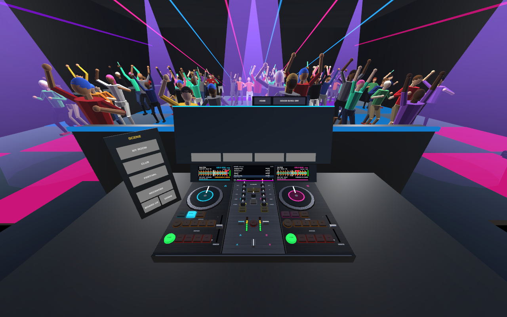 | 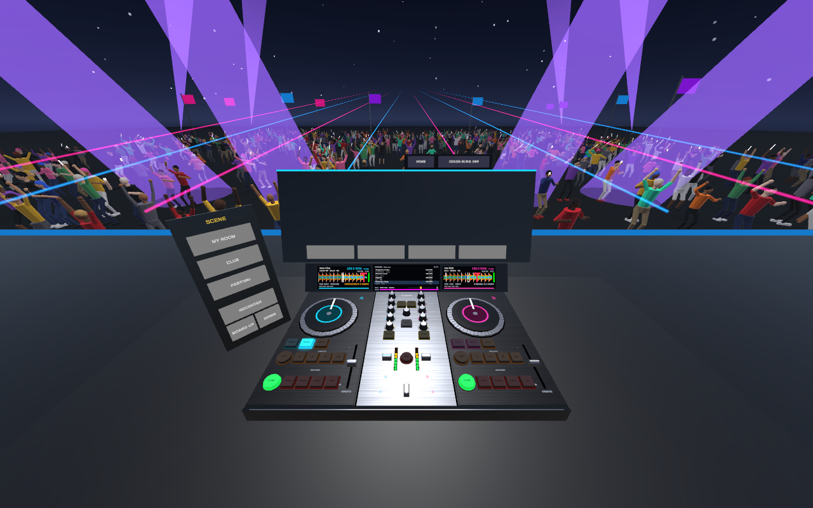 |

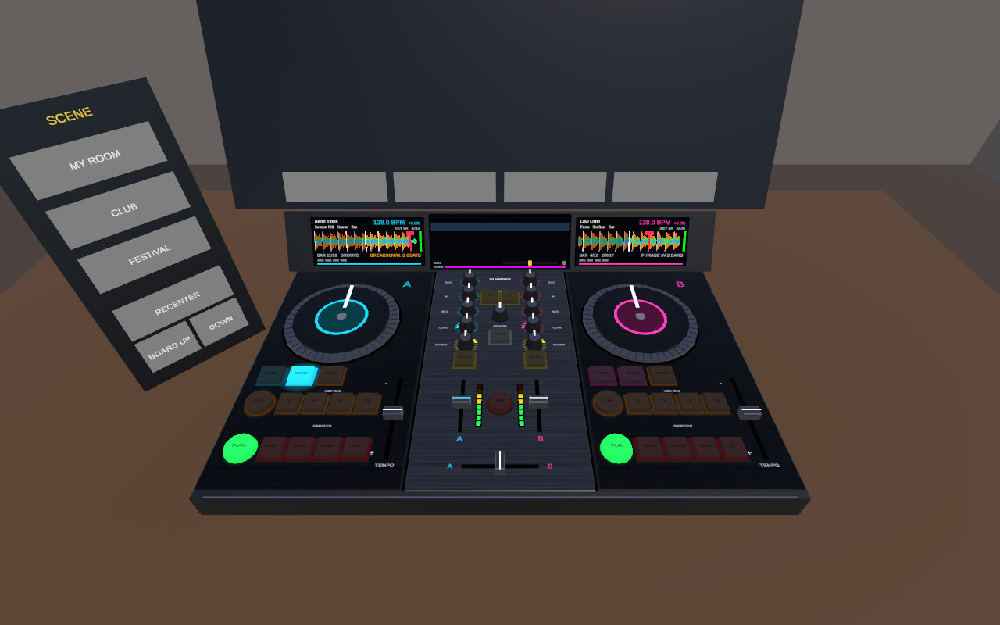

| Deck screens: waveform, BPM, key, time left, phrase countdown | Song browser |
|---|---|
| 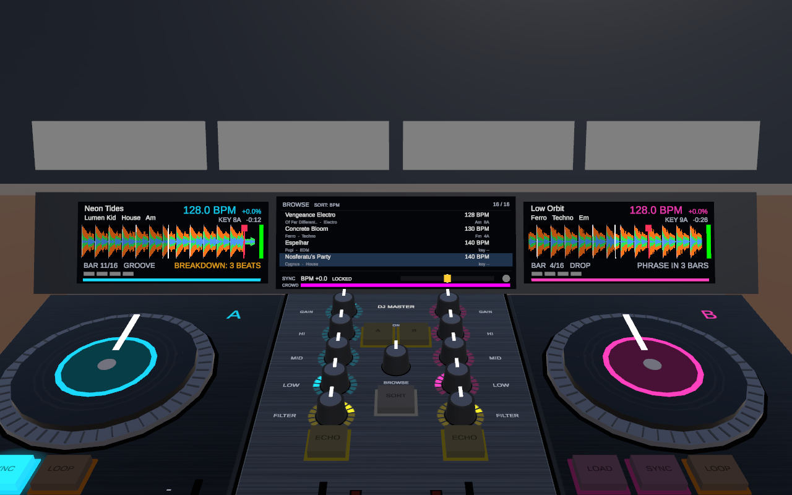 | 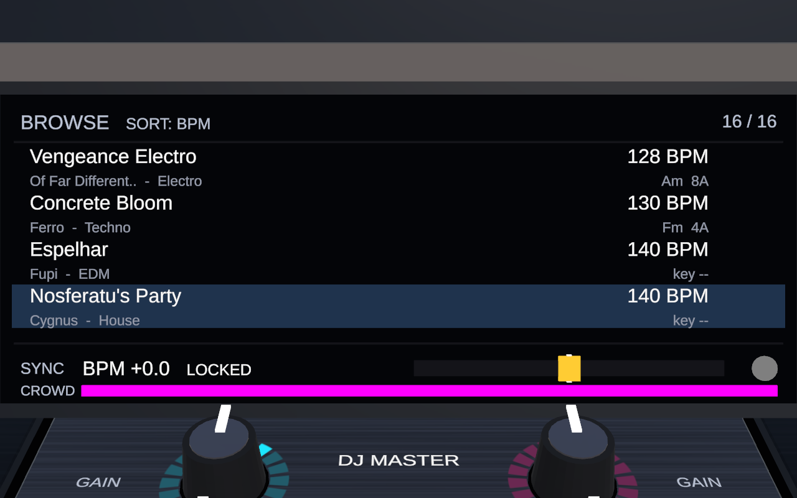 |

| Start screen | Who's playing? |
|---|---|
| 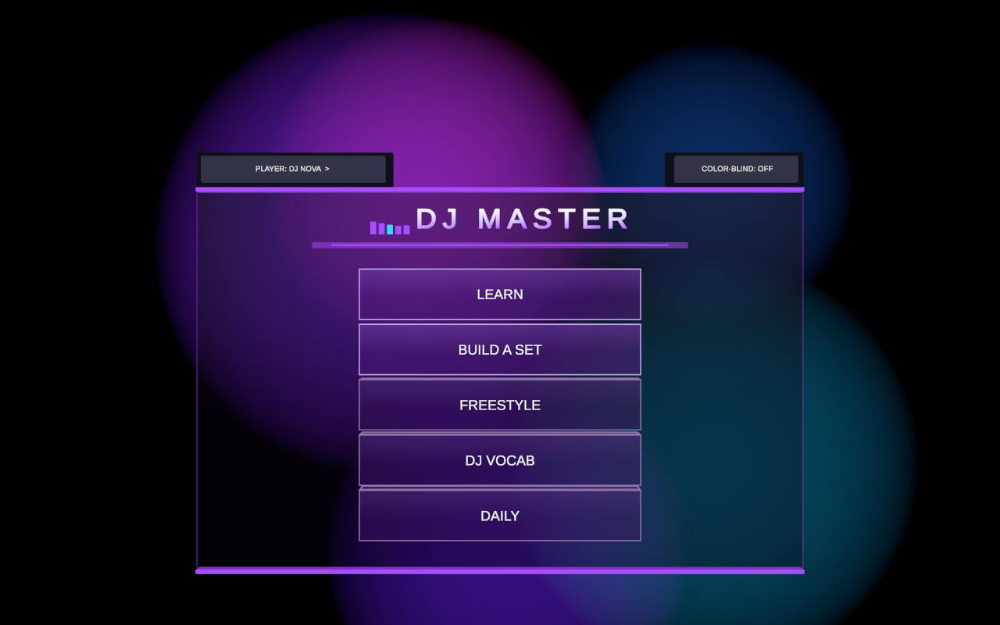 | 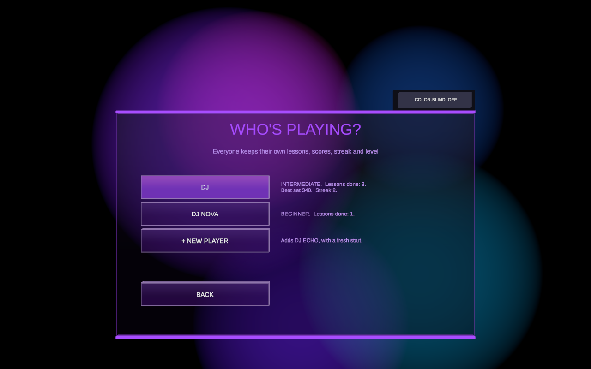 |

| Pick your level | Build a set (FREE MUSIC tab) |
|---|---|
| 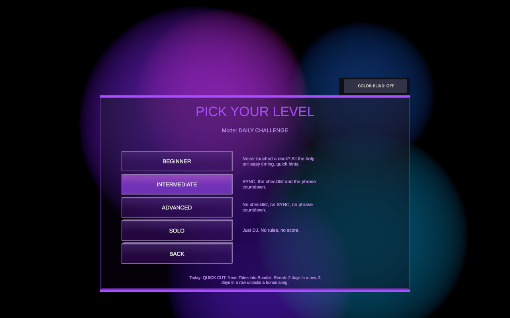 | 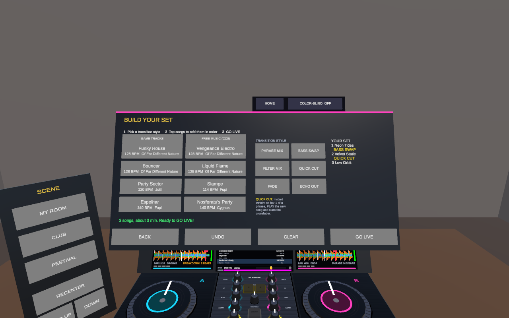 |

| DJ Vocab | Vocab quiz |
|---|---|
| 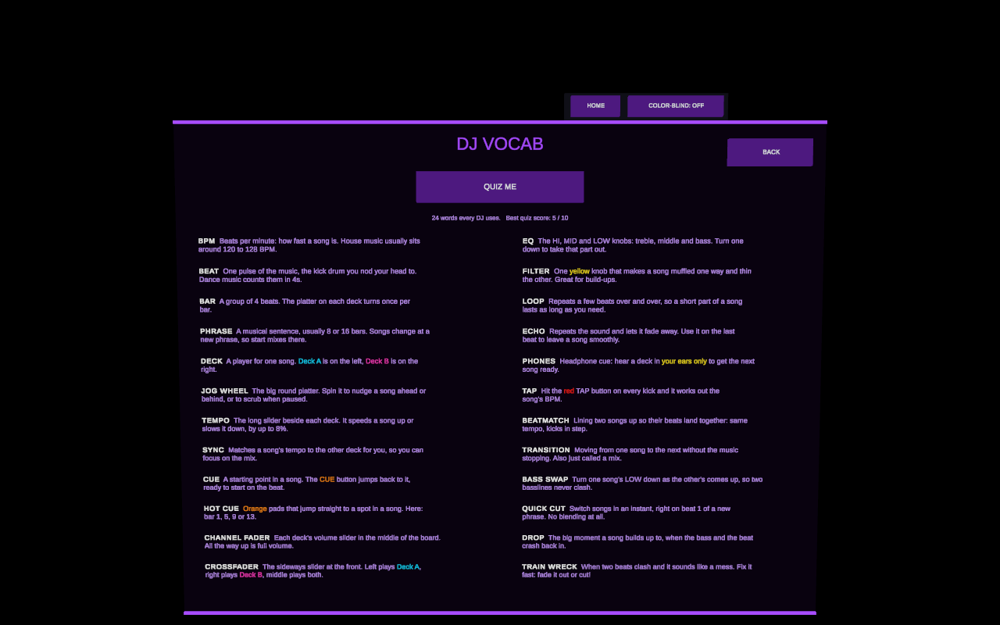 | 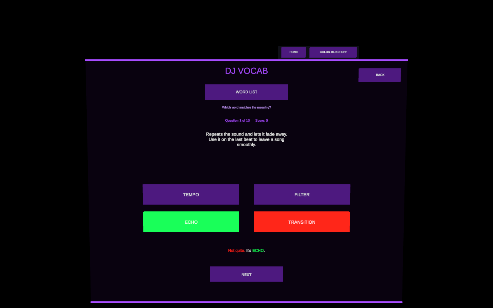 |

*Editor renders. On Quest, the "room" view is your real room through passthrough.*

## Color code

Every control has a color, and Learn mode opens with a quick quiz on it:

| Color | Means |
|---|---|
| Blue | Deck A (left), including its LOAD and SYNC |
| Pink | Deck B (right) |
| Green | PLAY |
| Orange | CUE, the HOT CUE pads (jump to bar 1, 5, 9 or 13) and LOOP |
| Yellow | FILTER, ECHO and PHONES: effects, and what only you hear |
| Red | TAP and the SAMPLER pads (horn, cheer, siren, zap): for the crowd |

**COLOR-BLIND mode** (on the start screen) swaps in a palette that stays distinct for every common type of color
blindness, and gives every color a shape, on the board and in every lesson, so nothing relies on color alone:
◄ Deck A, ► Deck B, ● PLAY, ■ CUE, ♦ FX and PHONES, ♥ CROWD. The setting is saved between sessions.

## What you learn

The lessons follow the techniques chapter of Digital DJ Tips' free *Rock The Dancefloor* course
(the basic DJ workflow, the three elements of a beatmix, the five basic transitions, sync, hot cues and loops,
EQ, filters and effects, and recording and critiquing your sets), rebuilt as hands-on steps.

**Lesson 1: First Mix** (21 steps, about 7 minutes). The control you need next pulses gold, and a hint appears if you're stuck.

| # | Skill | What you do |
|---|---|---|
| 1 | The drop | Music is already playing with the bass cut. Turn LOW back up and the crowd goes off, all inside the first minute |
| 2-5 | Color code | Touch something blue, pink, yellow and orange |
| 6-8 | Decks and faders | Press PLAY, raise the channel fader, crossfade to Deck A |
| 9 | Feel the beat | Tap the TAP pad on four kicks in a row |
| 10 | Phrasing | Tap exactly on a 4-bar line (bar 1, 5, 9, 13) |
| 11-13 | Cueing | LOAD Deck B, preview it in the headphones (PHONES), press PLAY |
| 14 | Beatmatch: tempo | Ride Deck B's TEMPO fader until both BPMs match |
| 15 | Beatmatch: phase | Nudge Deck B's jog wheel until the SYNC light turns green |
| 16-19 | The blend | Cut the bass, bring Deck B in, swap the basslines, finish the transition |
| 20-21 | Effects | Filter sweep and the air horn |

**Lesson 2: Fade & Cut** (14 steps, about 4 minutes): the DJ loop (load, preview in PHONES, set the GAIN so both songs
hit the same level on the meters, cue, bring in, stop the old song), then a **fade** (a clear dip, about 10 seconds of fading, the new song dropped on a phrase; it tells you if you fade too fast)
and a **cut** (hot cue to bar 1, then PLAY and crossfader together on a phrase line, with no overlap).

**Lesson 3: Sync, Loops & FX** (11 steps, about 5 minutes): tap tempo (it shows the BPM you tap), SYNC, a
**single-phrase beatmix** held for 8 bars, a 4-bar **loop**, and an **echo out**, ending with "less is more".

**Lesson 4: Next Song** (8 steps, about 5 minutes): sort the browser by BPM and find a song close enough to beatmix, sort
by KEY and find one that also fits on the Camelot wheel, hear a clashing pick beat-matched in your headphones, then LOAD
your pick, SYNC it, hear how it sits, and mix it in for a cheer.

## The board

| Part | What it shows |
|---|---|
| **Deck screens** | A three-band waveform (lows warm, mids green, highs blue) scrolling under a center playhead, with beat, bar and phrase lines from the song's beatgrid. Big BPM and tempo, the Camelot key, time left, the bar and section, and a countdown to the next phrase. |
| **Song browser** | The middle screen. Turn BROWSE to scroll, SORT by crate, BPM or key, and LOAD puts the highlighted song on a deck. Against the song that's playing, BPM and key show green when they mix, yellow when they need a fade or cut, red when they clash. It won't load over a deck the crowd can hear. |
| **LEDs** | Every knob has a ring that fills with its value (from the center for GAIN, EQ and FILTER). The level meters are segmented green, yellow, red. Pads have an LED rim in their color that lights when they're on and flashes on a press, and a fader cap's line lights up while you hold it. |

Color-blind mode recolors all of it, waveform included.

## Build a set

Tap a transition style, then tap songs in the crate to add them in order. The crate has two tabs: **GAME TRACKS** (the
eight synthesized songs) and **FREE MUSIC (CC0)** (eight real songs, below). You can mix both in one set, and LOAD in
Freestyle cycles through all sixteen. Each song is mixed in with the style that was selected when you added it:

| Style | How it's done | Graded on |
|---|---|---|
| Phrase mix | Preview in PHONES, beatmatch, bring it in on a phrase, play both for about 8 bars, crossfade. | 4-20 bars in sync, entered on a phrase line |
| Bass swap | Cut the new song's LOW, beatmix, then trade basslines. | New LOW cut on entry, no muddy bass, no clashing |
| Filter mix | Beatmix while sweeping the old song's FILTER. | Filter used, no clashing |
| Quick cut | Match the tempo, CUE to bar 1, then PLAY and slam the crossfader on a phrase line. | No overlap, on bar 1, 5, 9 or 13 |
| Fade | Dip the old song's fader, fade it over about 10 seconds, start the new song on a phrase. | 6-25 s fade, new song on a phrase |
| Echo out | ECHO on, cut the old song's fader on a phrase, drop the new song while the echoes fade. | Echo on at the cut, new song on a bar line within 4 s |

The builder warns when a beatmix joins songs more than 4% apart in tempo, and suggests a fade, cut or echo out instead.

**GO LIVE** performs the set. The next song is loaded for you, and a checklist walks you through each planned
transition with the right controls glowing. Each transition is graded PERFECT / GOOD / ROUGH with a tip. Crowd energy
rises for in-sync blends and bass drops (cut the LOW, slam it back on a bar line). It falls for trainwrecks, muddy
bass clashes, silence and leaving the ECHO on for too long (less is more). Your set is saved between sessions.

After the set, **LISTEN BACK** replays a recording of each transition, and a critique shows how much of your mixing
time the beats were in sync, the seconds of clashing and silence, and the one thing to practise next.

### Free music

Real songs their artists released as **CC0 1.0 (public domain)** on [OpenGameArt.org](https://opengameart.org). Each is a
16-bar section cut so beat 1 lands exactly on the first sample (checked to within 0.3 ms), looped seamlessly and
loudness-matched to the game tracks, so SYNC, hot cues, beatmatching and grading work just as they do on the built-in songs.
Full credits are in `Assets/DJMaster/Resources/Music/CREDITS.md`.

| Song | Artist | BPM |
|---|---|---|
| [Funky House](https://opengameart.org/content/funky-house) | Of Far Different Nature | 128 |
| [Vengeance Electro](https://opengameart.org/content/vengeance-electro) | Of Far Different Nature | 128 |
| [Bouncer](https://opengameart.org/content/bouncer-0) | Of Far Different Nature | 128 |
| [Liquid Flame](https://opengameart.org/content/liquid-flame) | Of Far Different Nature | 125 |
| [Party Sector](https://opengameart.org/content/party-sector) | Joth | 120 |
| [Slampe](https://opengameart.org/content/slampe-synthwave-house) | Fupi | 114 |
| [Espelhar](https://opengameart.org/content/espelhar-loud-melodic-edm) | Fupi | 140 |
| [Nosferatu's House Party](https://opengameart.org/content/nosferatus-house-party) | Cygnus | 140 |

## DJ Vocab

**DJ VOCAB** on the start screen lists 24 words every DJ uses, each with a one-line meaning that points at the real
control on the board: BPM, beat, bar, phrase, deck, jog wheel, tempo, sync, cue, hot cue, channel fader, crossfader,
EQ, filter, loop, echo, phones, tap, beatmatch, transition, bass swap, quick cut, drop and train wreck.

**QUIZ ME** asks 10 questions. Each shows a meaning with the word blanked out and four words to pick from. The right
answer lights green (and your pick red if it was wrong), and the best score is saved. Color-blind mode applies here too.

## Hand controls

| Control | Gesture |
|---|---|
| Buttons and pads | Poke down from above. Brushing past from the side won't trigger them. |
| Faders | Touch the cap and slide. The tempo fader is geared 1:3 for fine control and clicks into 0%. |
| Knobs | Touch the top and slide your finger away/right to turn up, toward you/left to turn down. Double-tap to reset to center. |
| SYNC / LOOP / ECHO | SYNC matches tempo and lines up the beats. LOOP repeats the current 4-bar phrase. ECHO is a beat-synced echo after the fader, so pulling the fader down lets the echoes ring out. |
| Jog wheels | Rest a fingertip on the platter and spin: clockwise speeds the track up, counter-clockwise slows it. When paused, it scrubs. |

A glowing dot on each index fingertip shows exactly where you're touching, and turns gold while you're holding a control.
The platters turn once per bar with their white marker pointing forward on beat 1, so two in-phase tracks have matching markers.

**Scene panel** (to the left of the board): MY ROOM / CLUB / FESTIVAL, RECENTER, and BOARD UP / DOWN for comfort.

## Designed for the hackathon guidelines

- **Hands-first:** everything works with hands alone. Nothing needs a controller.
- **Seated, airplane-seat friendly:** the board snaps in front of you at desk height, with every control inside arm's reach. RECENTER and height buttons are always available.
- **First minute:** Lesson 1 starts with music already playing, and the first cheer comes as soon as you bring the bass back in.
- **Bus-stop test:** cold start lands you on the menu with tracks preloading. One lesson is 4 to 7 minutes and a 3-song set about 3. Taking the headset off or opening the system menu pauses audio and time, and the game resumes where you left off.
- **Original, not a wrapper:** the eight game tracks are synthesized at runtime by `TrackSynth` (house, techno and disco loops, arranged in DJ phrases). The eight FREE MUSIC songs are real tracks their artists released as **CC0 (public domain)** on OpenGameArt.org, each cut to a 16-bar loop that starts exactly on beat 1 and credited in `Assets/DJMaster/Resources/Music/CREDITS.md`. There is no licensed music, no streaming, and no third-party services.

## Run it in the editor (no headset)

1. Open the project in **Unity 6000.6.4f1** and open `Assets/Scenes/DJMaster.unity`.
2. Press Play. The view starts tilted down at the board, and the mouse acts as a fingertip:
   - **Left click / drag:** press buttons, drag faders, turn knobs (drag up/right), spin the jog wheels
   - **Scroll wheel:** turn the knob under the cursor, or zoom in and out anywhere else
   - **Right drag:** look around

Pressing Play rebuilds the scene first if `SceneBuilder` has changed since the scene was built, and turns off the Game
view's *Low Resolution Aspect Ratios* so text stays sharp. To rebuild by hand: **DJ Master > Build Scene**.
Tip: set the Game view to **Play Maximized** so small text is easy to read.

**First open of a fresh clone:** the Meta SDK can compile before the Input System and OpenXR packages finish importing,
which shows about 1800 errors. Nothing is wrong with the project. Quit Unity, delete `Library/ScriptAssemblies` and
`Library/Bee`, then open it again.

Input is **Input System only** (Project Settings > Player > Active Input Handling), so Android builds don't stop on the
"Active Input Handling is set to Both" dialog. The editor mouse mode reads `Mouse.current`.

## Build to Quest

1. **Unity Hub > Installs > 6000.6.4f1 > Add modules > Android Build Support** (include OpenJDK and Android SDK & NDK).
2. **DJ Master > Configure Player Settings for Quest** (IL2CPP, ARM64, min API 32, package `com.djmaster.vr`, hands only at high tracking frequency + passthrough).
3. **File > Build Profiles > Android > Switch Platform**.
4. **Edit > Project Settings > XR Plug-in Management > Android tab:** check **OpenXR**, then under OpenXR enable the **Meta XR** feature group. Then open **Edit > Project Settings > Meta XR**, pick the Android tab and click **Fix All**.
5. Put the Quest in developer mode, connect over USB, then **Build And Run**.

**Sharp rendering:** nothing to set by hand. 4x MSAA is in Quality settings, and the board's textures are mipmapped with anisotropic filtering. On the headset, `RenderQuality` starts at 1.2x eye resolution with dynamic foveation capped at Low, then steps down 0.1 at a time (never below 1.0x) if the frame rate stays under the display rate (72 Hz) for a few seconds. The log line `[DJMaster] Eye resolution ...` shows where it settled. There are no post effects. To check the frame rate, run OVR Metrics Tool in MY ROOM, CLUB and FESTIVAL with the full crowd.

**Meta sign-in (entitlement check + the player's name):** in the Meta Developer Dashboard, open the app, copy its **App ID**, then in Unity open **Window > Meta > Platform > Edit Settings** (older SDKs had it under **Meta > Platform**) and paste it into **Meta Quest/2/Pro**. On the Quest the game then checks the store entitlement at startup (it quits if that fails, as the store requires) and greets the signed-in user by name. With no App ID, in the editor or offline, it plays on as the local player.

**Don't commit your machine's settings:** setting up the release keystore and linking Unity Cloud write your keystore
path (`AndroidKeystoreName`) and the cloud project ids (`cloudProjectId`, `projectName`, `organizationId`) into
`ProjectSettings/ProjectSettings.asset`. Unstage those lines before committing (`git add -p ProjectSettings/ProjectSettings.asset`),
and keep the keystore and its passwords out of the repo.

**For the competition:** upload the APK to a release channel named **Competition** in the Meta Developer Dashboard and create an Invite URL for the judges.

## Tests

- **EditMode (123):** mixer math (constant-power crossfader, EQ curve, tempo range, phase wrap, gain and meter zones),
  synth loop length, levels and kick timing, beat detection, key and tempo matching (Camelot wheel), the song browser's sorting,
  the waveform analysis, phrase countdown text, skill level rules, players and their separate saves, the daily challenge and
  streak, set lists, desk placement and reach, the color-blind palette and shapes (and that the font has a glyph for each), text wrapping, and the DJ vocab list and quiz.
- **PlayMode (43):** loads the real scene and drives it with a simulated fingertip. Covers pokes, slow pokes, fader drags,
  knobs, venue switching, HOME and BACK from every screen, the color-blind toggle, gain and meters, the deck screens'
  waveform and phrase countdown, LED rings, press flashes and fader glows, the song browser, full runs of all four lessons
  (including music within 10 seconds and a cheer within a minute in Lesson 1), building and performing sets (phrase mix,
  quick cut, fade, echo out) with LISTEN BACK, the daily challenge, beatgrids for your own songs, picking players and skill levels,
  and the room scan timing. The tests run muted.

Run them from **Window > General > Test Runner**.

## Project map

```
Assets/DJMaster/
  Scripts/Audio/        TrackSynth (procedural music), TrackLibrary, Deck (hot cues, loops), ChannelStrip (EQ/filter/echo DSP),
                        Mixer, MixRecorder (listen back), Sfx, DJMath, MixMatch (key + tempo matching), BeatDetector +
                        BeatGridStore (beatgrids for your own songs), Waveform (three-band waveforms for the deck screens)
  Scripts/Interaction/  Pointer, HandPointerSource (index fingertip), MousePointerSource, PokeButton, Fader, Knob, JogWheel
  Scripts/Game/         GameDirector (menus and modes), LessonDirector (Learn), SetList + SetPerformer (Build a set / live show),
                        MixJudge (crowd energy + score), DJBoard, Players, Skill + SkillLevel (levels), DailyChallenge,
                        GridEditor
  Scripts/UI/           BoardColors + ColorSafeView (the color code, color-blind mode), StartMenu, VocabPanel + DJVocab,
                        DeckDisplay, SongBrowser, LevelMeter, PhraseCue, SyncMeter, InstructionPanel, SetBuilderPanel,
                        SystemButtons (HOME / COLOR-BLIND), MenuBackdrop (all text is TextMeshPro)
  Scripts/World/        EnvironmentManager (passthrough/club/festival), SeatedAnchor, DeskSnap + DeskPlacement (board on
                        your real desk), LightShow, MeshKit,
                        Crowd (GPU-instanced dancers with two-bone arms and legs, per-person looks)
  Resources/Music/      8 CC0 songs as beat-aligned 16-bar loops, plus CREDITS.md
  Shaders/              Additive + Glow (single-pass stereo safe), CrowdInstanced (per-person colors),
                        LedRing (knob LEDs), Waveform (deck screens)
  Editor/SceneBuilder.cs  builds the entire scene from primitives
  Editor/               SceneAutoRebuild (rebuilds a stale scene on Play), MusicImport (sample-accurate audio import),
                        GameViewSharpness (full-resolution Game view), DJMasterSubmission (competition checks + APK build)
```

Built with the Meta XR Core SDK v207 (OVRCameraRig, OVRHand/OVRSkeleton with OpenXR hand skeletons, OVRPassthroughLayer).
